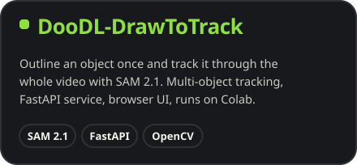
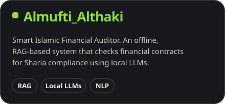
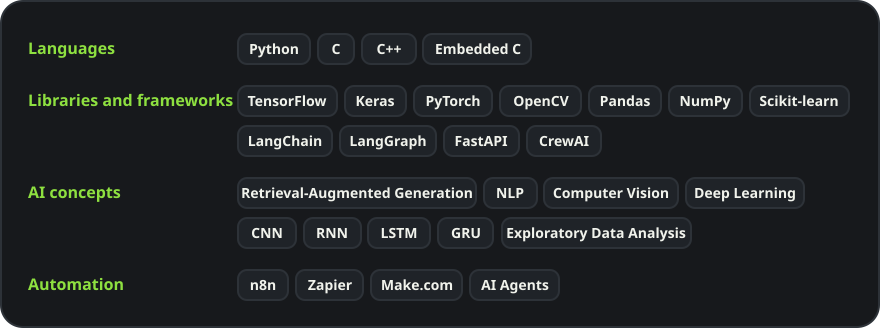

  

  
  &nbsp;
  

## Selected projects

<table>
  <tr>
    <td width="50%" valign="top">
      
    </td>
    <td width="50%" valign="top">
      
    </td>
  </tr>
</table>

## Skills

## Get in touch

Reach me on [LinkedIn](https://www.linkedin.com/in/ahmed-elmasry-essam/) or at [a7medessam710@gmail.com](mailto:a7medessam710@gmail.com).
